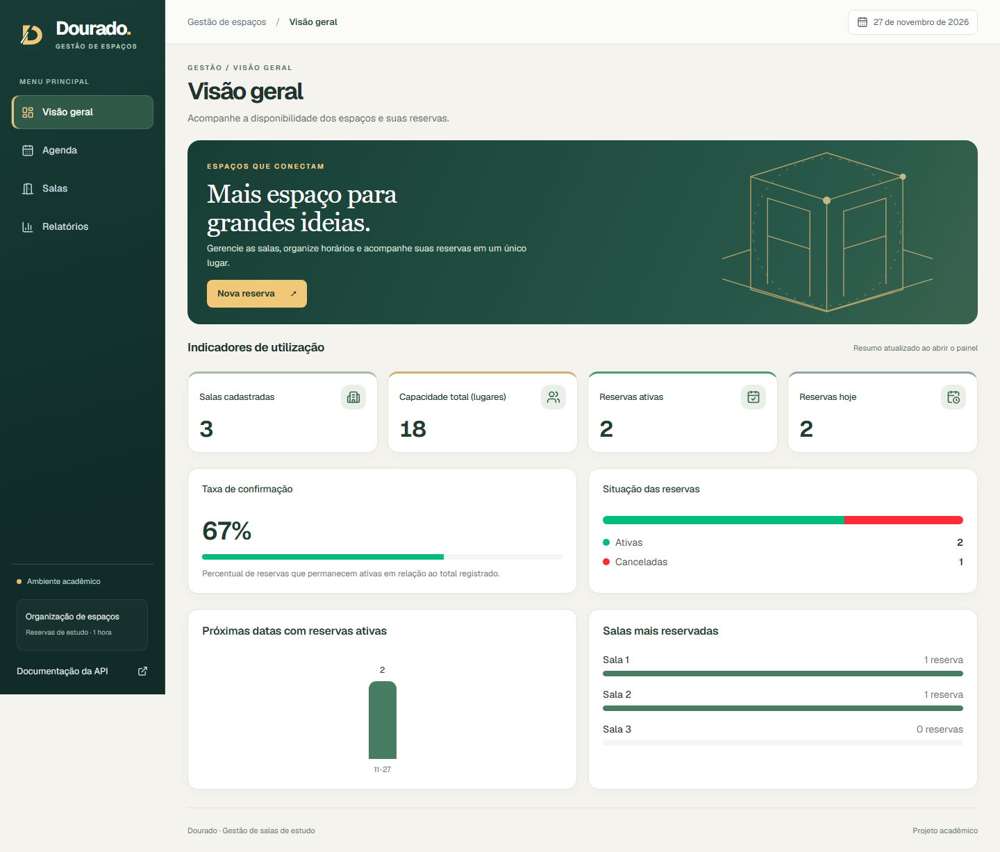
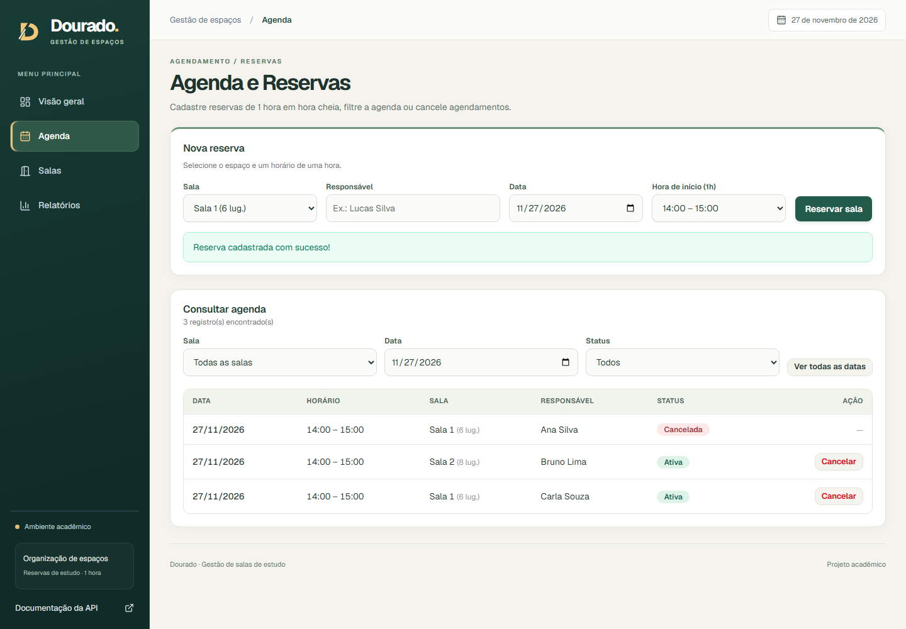
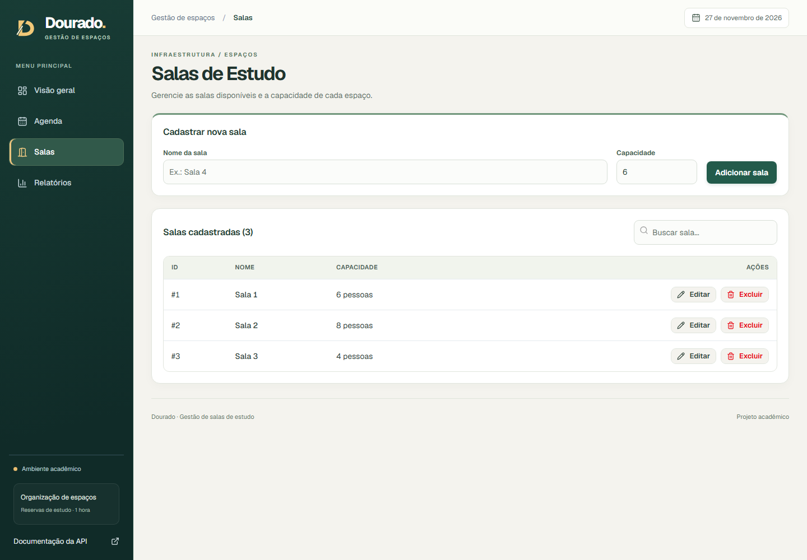
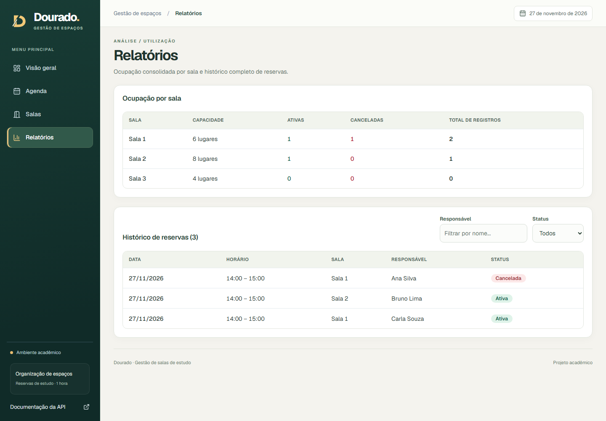
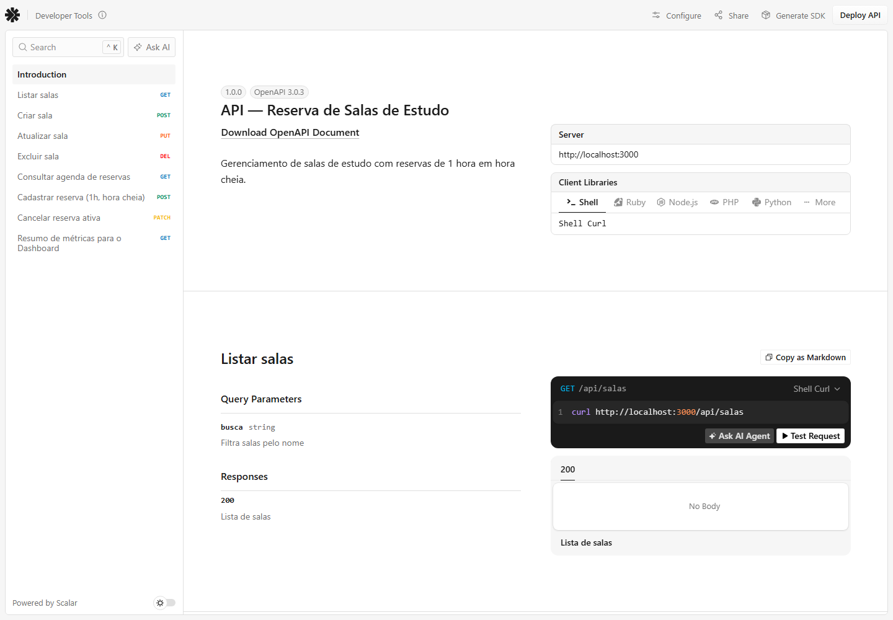

# Dourado | Reserva de Salas de Estudo

## Sobre o projeto

Aplicação web desenvolvida para auxiliar a equipe de uma unidade acadêmica no gerenciamento das salas de estudo. O sistema organiza reservas de uma hora, iniciadas em hora cheia, e impede que uma mesma sala seja reservada duas vezes na mesma data e horário.

## Funcionalidades

Atendem ao escopo solicitado:

- **Agenda:** cadastro de reservas com sala, nome fictício do responsável, data e hora de início; consulta por sala, data e status; cancelamento de reservas.
- **Salas:** cadastro de salas com nome e capacidade (necessário para as reservas).

Complementares, além do escopo mínimo:

- **Visão geral:** indicadores de salas, capacidade, reservas ativas e canceladas, reservas do dia, próximas datas com reservas ativas e ranking de salas.
- **Relatórios:** totais por sala e histórico de reservas com filtros por status e responsável.
- **Documentação API:** referência interativa Scalar baseada em OpenAPI 3.0.3.

## Tecnologias

| Tecnologia | Finalidade |
|---|---|
| React e TypeScript | Interface e tipagem da aplicação |
| Vite | Servidor de desenvolvimento e build do frontend |
| Tailwind CSS, shadcn/ui e Radix UI | Estilização e componentes |
| Bun | Runtime, gerenciamento de dependências e servidor HTTP |
| SQLite (bun:sqlite) | Persistência local dos dados |
| OpenAPI e Scalar | Documentação dos endpoints |

## Como executar

Pré-requisito: Bun instalado e disponível no terminal (`bun --version`). Abra a pasta que contém o `package.json` com o script `dev` (normalmente `DOURADO-main`), e não a pasta externa do ZIP. Na raiz do projeto, execute:

```bash
bun install
bun run dev
```

Acesse:

- Interface: http://localhost:5173
- API: http://localhost:3000
- Documentação interativa: http://localhost:5173/docs (também disponível diretamente na API em http://localhost:3000/docs)
- Especificação OpenAPI: http://localhost:3000/openapi.json

A inicialização cria as tabelas e, caso não existam salas cadastradas, insere Sala 1 (6 pessoas), Sala 2 (8 pessoas) e Sala 3 (4 pessoas). O banco fica em `apps/api/reservas.sqlite`.

## Testes e verificações

Com a API em execução (`bun run dev` ou `bun run dev:api`), execute em outro terminal:

```bash
bun run test:api
```

O script `scripts/testar-api.ts` executa o roteiro obrigatório (T01–T07 e T14) e as validações da API e de casos de borda. Ele usa uma data de teste nova a cada execução, portanto pode ser repetido sem conflito, e cancela os registros que criou ao final. O resultado é exibido no terminal e o código de saída é `0` apenas se todas as verificações passarem.

Para verificar a tipagem, execute `bun run typecheck`. Para gerar o build do frontend, execute `bun run --cwd=apps/web build`.

## Como utilizar

1. Abra a Agenda e selecione uma sala.
2. Informe um nome fictício, uma data e uma hora cheia.
3. Cadastre a reserva e consulte a agenda usando os filtros.
4. Caso tente reservar a mesma sala na mesma data e hora, o sistema rejeitará a solicitação.
5. Para liberar o horário, cancele a reserva ativa. O registro permanece no histórico com status cancelado.

## Documentação complementar

- [Arquitetura e regras de negócio](arquitetura.md)
- [Requisitos e regras de negócio](docs/requisitos.md)
- [Manual do usuário](docs/manual-usuario.md)
- [Referência da API](docs/api.md)
- [Roteiro de testes e critérios de aceitação](docs/testes.md)
- [Identidade visual](docs/design.md)
- [Reprodução das capturas](docs/capturas.md)

## Identidade visual e demonstração

Dourado combina verde-floresta, dourado suave e superfícies claras, com navegação lateral e componentes consistentes.

As capturas abaixo foram feitas na execução local de 27/11/2026, com a versão revisada: barra lateral corrigida, título "Próximas datas com reservas ativas" no painel e confirmação antes de excluir sala. Para refazê-las, siga [a reprodução das capturas](docs/capturas.md).

### Visão geral



### Agenda de reservas



### Gerenciamento de salas



### Relatórios



### API interativa



[Ver captura integral da API](docs/evidencias/api-scalar.png).

## Validação

O cenário obrigatório está descrito em [Testes e evidências](docs/testes.md). Nesta revisão, `bun run test:api` foi executado com 33 verificações aprovadas (roteiro, validações complementares, tipos e casos de borda). As capturas visuais do roteiro original estão em `docs/evidencias/`.
