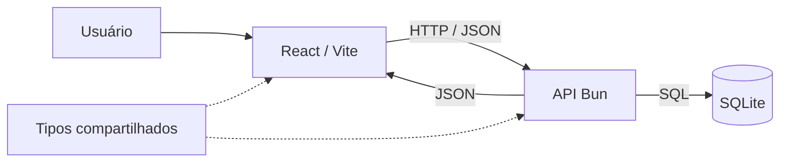
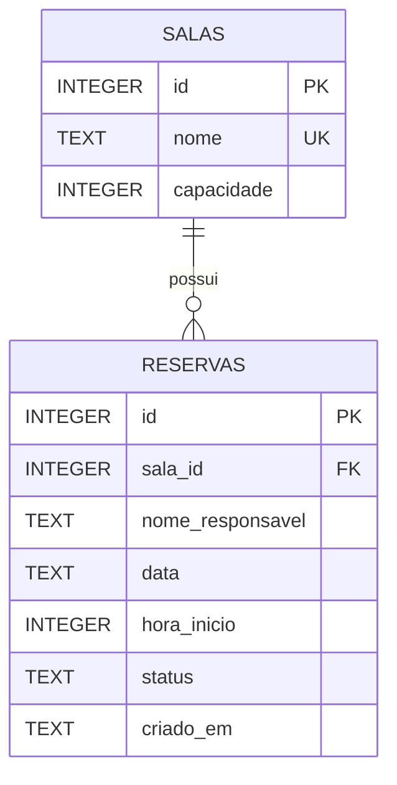

# Arquitetura do sistema

## 1. Visão geral

O projeto utiliza uma arquitetura cliente-servidor organizada em monorepositório, com frontend, API e tipos compartilhados. O navegador envia requisições HTTP à API, que valida os dados, executa as operações no SQLite e retorna respostas JSON.



## 2. Organização dos arquivos

```text
apps/
  api/
    src/db.ts          # Conexão, tabelas, índices e dados iniciais
    src/index.ts       # Servidor HTTP, rotas e validações
    src/openapi.ts     # Especificação OpenAPI
    reservas.sqlite    # Banco de dados (criado automaticamente na primeira execução)
  web/
    src/App.tsx        # Navegação entre páginas
    src/pages/         # Dashboard, Agenda, Salas e Relatorios
    src/components/ui/ # Componentes de interface
    src/lib/api.ts     # Cliente HTTP
    src/index.css      # Estilos e identidade visual
    vite.config.ts     # Proxy para a API
packages/
  tipos/index.ts       # Interfaces e DTOs compartilhados
scripts/
  testar-api.ts        # Testes de aceitação da API (bun run test:api)
  capturar.py          # Capturas de tela com Playwright
docs/                  # Requisitos, API, testes, manual, design e evidências
```

O Vite utiliza a porta 5173 e encaminha `/api`, `/docs` e `/openapi.json` ao servidor Bun na porta 3000. Os tipos compartilhados definem os contratos de salas, reservas e indicadores.

## 3. Modelo de dados



Uma sala pode possuir várias reservas; cada reserva pertence a uma única sala. A capacidade deve ser inteira e positiva, o nome da sala é único e a hora de início é um inteiro de 0 a 23. A data é armazenada como texto no formato AAAA-MM-DD. O status pode ser `ativa` ou `cancelada`, sendo `ativa` o padrão. O banco utiliza chaves estrangeiras e modo WAL. A exclusão de uma sala exclui suas reservas em cascata.

## 4. Regra de negócio principal

A proteção contra reservas duplicadas é implementada diretamente no banco por um índice único parcial:

```sql
CREATE UNIQUE INDEX IF NOT EXISTS idx_reserva_unica_ativa
ON reservas (sala_id, data, hora_inicio)
WHERE status = 'ativa';
```

Assim, duas reservas ativas não podem compartilhar a mesma sala, data e hora. Salas diferentes podem ser reservadas simultaneamente. Quando uma reserva é cancelada, ela deixa de participar do índice e o horário pode ser reservado novamente. O cancelamento preserva o registro para consultas e relatórios.

### Validação na API

A API valida o tipo e o conteúdo de cada campo antes de qualquer operação no banco:

- **Números inteiros** (sala, hora de início, capacidade): aceitam somente números inteiros reais. Texto (`"6"`), booleanos, `null` e decimais são rejeitados com HTTP 400.
- **Sala** em reservas: inteiro positivo; se a sala não existir, HTTP 404.
- **Responsável**: texto não vazio.
- **Data**: formato AAAA-MM-DD e existente no calendário (2026-02-31 é rejeitada).
- **Hora de início**: inteiro de 0 a 23 (hora cheia).
- **Filtros da agenda**: sala deve ser inteiro positivo ou `todas`; data segue as mesmas regras; status deve ser `ativa`, `cancelada` ou `todos`.

Em caso de conflito de reserva, a API retorna HTTP 409 com a mensagem `Esta sala já está reservada nessa data e horário.`. Cancelar uma reserva que já está cancelada também retorna 409. A duração de uma hora é representada implicitamente pela hora de início, sem campo de término no banco. A interface oferece horários de início entre 08h e 22h, enquanto a API aceita inteiros de 0 a 23.

## 5. Endpoints

| Método | Rota | Finalidade |
|---|---|---|
| GET | `/api/salas` | Listar salas; filtro opcional `busca` |
| POST | `/api/salas` | Cadastrar sala |
| PUT | `/api/salas/:id` | Atualizar sala |
| DELETE | `/api/salas/:id` | Excluir sala e suas reservas |
| GET | `/api/reservas` | Consultar reservas; filtros `salaId`, `data`, `status` |
| POST | `/api/reservas` | Criar reserva |
| PATCH | `/api/reservas/:id/cancelar` | Cancelar reserva ativa |
| GET | `/api/dashboard` | Consultar indicadores |
| GET | `/docs` | Referência interativa Scalar |
| GET | `/openapi.json` | Especificação OpenAPI |

Respostas principais: 200 (sucesso), 201 (criação), 400 (dados ou filtros inválidos), 404 (recurso inexistente) e 409 (conflito: reserva duplicada, cancelamento repetido ou nome de sala já usado). Erros de servidor inesperados retornam 500.

Exemplo de corpo JSON para criação de reserva (considerando que a sala de ID 1 existe):

```json
{"salaId": 1, "nomeResponsavel": "Ana Silva", "data": "2026-12-01", "horaInicio": 14}
```

## 6. Limites da implementação

O sistema foi estruturado para uso local e não implementa autenticação ou controle de acesso. A API não impede reservas em datas passadas. A capacidade é informativa, pois não há campo de quantidade de participantes. O gráfico de datas do painel mostra as próximas datas (a partir de hoje) com reservas ativas, até sete. A interface Scalar utiliza um script externo via CDN. Esses pontos não alteram a regra central de exclusividade das reservas, mas devem ser considerados em uma futura implantação institucional.

A data atual da agenda (navegador) e dos indicadores (servidor) usa o fuso local da máquina. Não há implantação de produção verificada.
