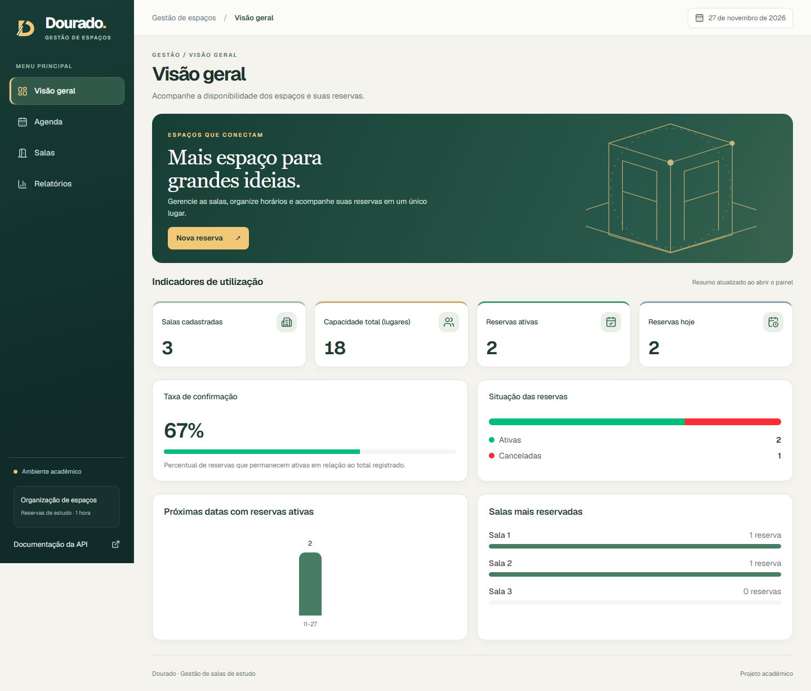

# Identidade visual — Dourado

A interface usa verde-floresta, dourado suave e superfícies claras. O símbolo vetorial (`apps/web/public/favicon.svg`) combina a inicial D com um corte diagonal, remetendo à abertura de um espaço. A família Geist Variable, já instalada no projeto, permanece na interface; títulos editoriais do banner do painel usam Georgia. O painel possui um atalho para a agenda, indicadores diferenciados e ilustração vetorial arquitetônica. Formulários, navegação e tabelas compartilham a mesma hierarquia visual.

## Paleta e aplicação

| Cor | Hex | Uso | Onde está |
|---|---|---|---|
| Verde-floresta | `#173B36` | Fundo do símbolo (favicon) | `favicon.svg` |
| Verde-floresta escuro | `#183C35` → `#102B28` | Fundo da barra lateral (gradiente) | `.app-sidebar` em `index.css` |
| Verde | `#235B4B` | Ações, botões principais e destaques | `--primary` em `index.css` |
| Dourado | `#F1C878` | Marca "Dourado." e botão de ação do banner | `.brand-name span`, `.hero-action` |
| Dourado de destaque | `#E8BC70` e `#EDC47E` | Ponto de status da barra lateral e marca do item ativo do menu | `.note-dot`, `.app-nav button[aria-current=page]` |
| Marfim | `#F4F3EE` | Fundo das páginas | `--background` em `index.css` |
| Grafite | `#20342E` | Textos principais | `--foreground` em `index.css` |

Os tons `#E8BC70` e `#EDC47E` são variações próximas de `#F1C878`, usadas em elementos pequenos. A regra base de `.app-sidebar` (linha 143 de `index.css`) define o gradiente documentado acima. O arquivo ainda contém ajustes responsivos posteriores, em blocos de media query no fim do arquivo; eles devem ser revisados visualmente em telas estreitas.

As capturas acima foram feitas com a versão revisada. Consulte [os testes](testes.md) e [a reprodução das capturas](capturas.md).
