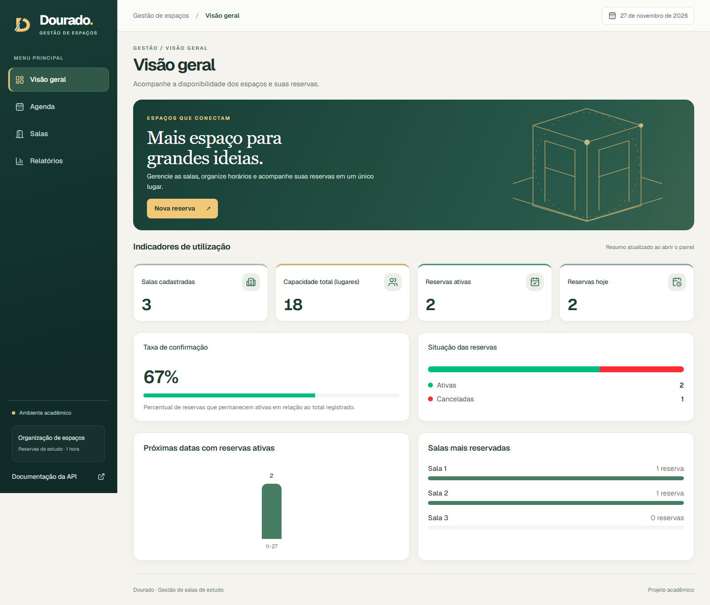
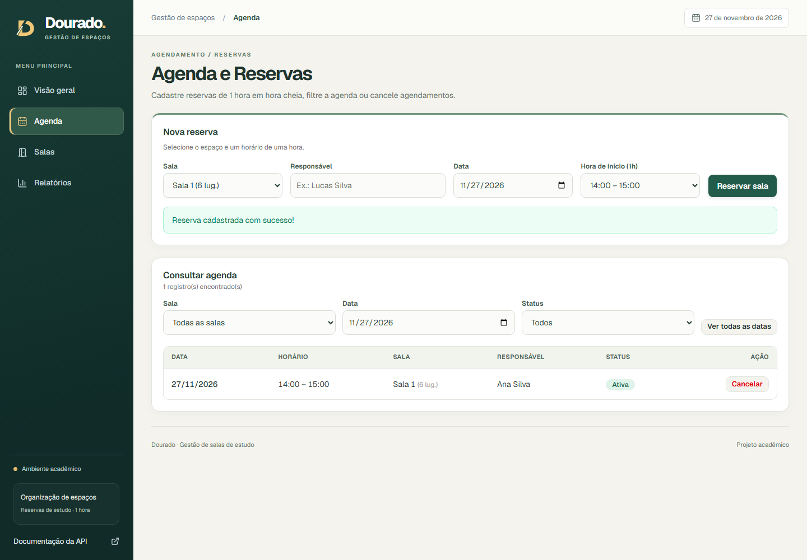
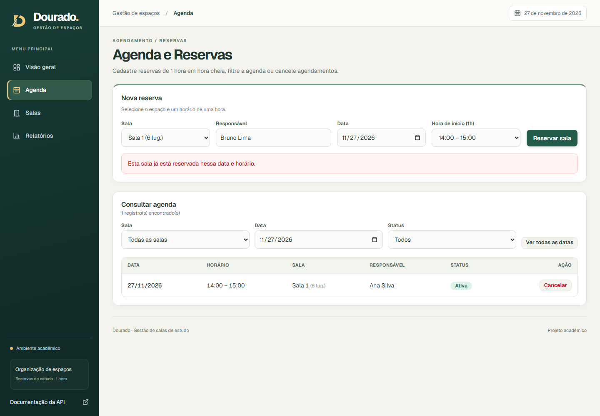
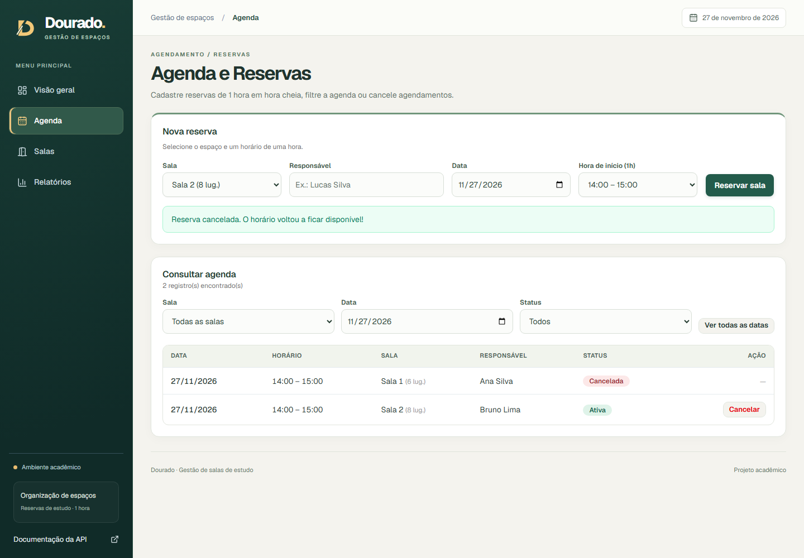
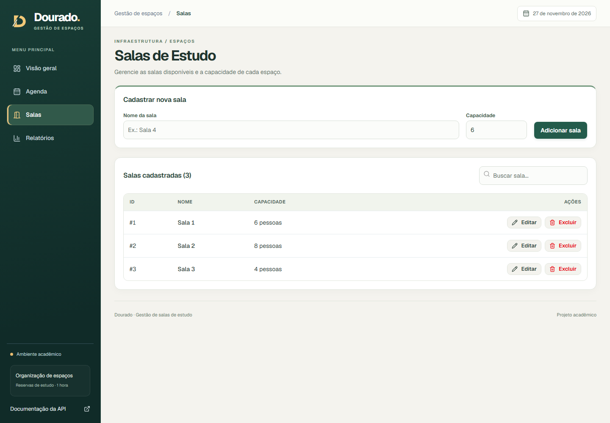
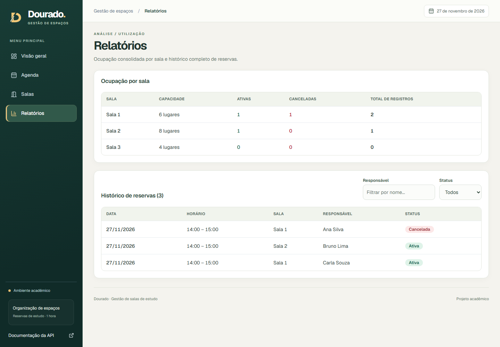
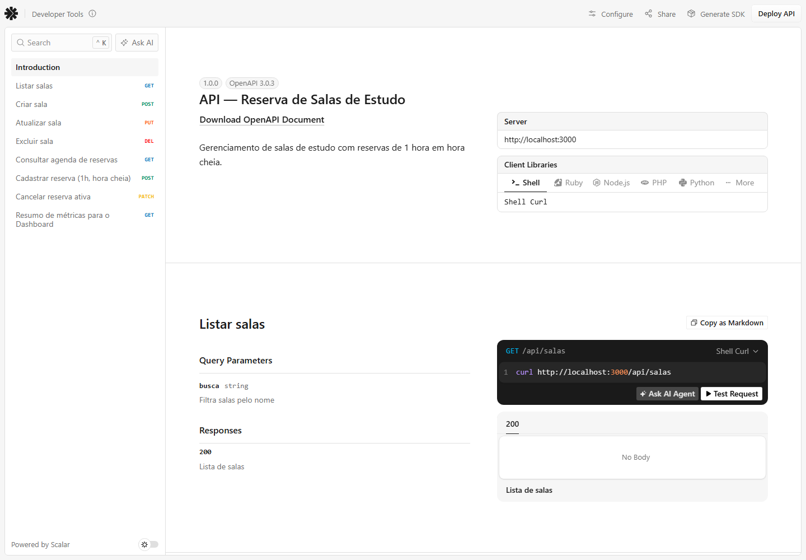

# Manual do usuário

## Acesso

Com a aplicação iniciada conforme o [README](../README.md), acesse http://localhost:5173. Utilize o menu lateral para navegar. Não há autenticação na versão atual. Utilize nomes fictícios nas demonstrações.

As capturas deste manual foram feitas com a versão revisada, incluindo a barra lateral ajustada e o título atualizado do gráfico do painel.

## Visão geral

Apresenta quantidade de salas, capacidade total em lugares, reservas ativas, reservas do dia, taxa de confirmação, distribuição entre ativas e canceladas, próximas datas com reservas ativas e ranking de salas.

O gráfico "Próximas datas com reservas ativas" mostra até sete datas, a partir de hoje. Datas passadas não aparecem.

## Agenda

1. Selecione Agenda no menu lateral.
2. Em Nova reserva, escolha a sala, informe o responsável, a data e o horário.
3. Clique em Reservar sala. A confirmação aparece na tela e o registro é exibido na agenda conforme os filtros.
4. Caso haja conflito, a mensagem informa que a sala já está reservada. Escolha outra sala ou horário. O sistema não sobrescreve a reserva existente.

### Consultar e cancelar

Na área de consulta, selecione sala, data e status. Para remover o filtro de data, utilize o botão "Ver todas as datas". Clique em Cancelar na linha de uma reserva ativa para liberar o horário. O registro cancelado continua no histórico. Uma reserva cancelada não pode ser cancelada de novo; a linha mostra um traço no lugar do botão.

## Salas

No menu Salas, informe nome e capacidade para cadastrar uma sala. A capacidade deve ser um número inteiro maior que zero. Utilize a busca pelo nome para localizar registros. As ações da tabela permitem editar ou excluir salas.

**Atenção:** excluir uma sala também exclui todas as suas reservas, e essa ação não pode ser desfeita. A interface pede confirmação antes de excluir. Prefira cancelar reservas quando precisar manter o histórico.

## Relatórios

No menu Relatórios, consulte a quantidade de reservas ativas, canceladas e totais de cada sala. O histórico pode ser filtrado por status e por nome do responsável. O resumo por sala é calculado sobre todos os registros, independentemente desses filtros.

## Documentação da API

Clique no link de documentação no rodapé do menu ou abra http://localhost:5173/docs. O Scalar lista as operações e seus parâmetros. Consulte [a referência da API](api.md).

[Captura integral](evidencias/api-scalar.png)

## Solução de problemas

| Problema | Ação |
|---|---|
| Script dev não encontrado | Abra a pasta raiz que contém o package.json com o script dev. |
| Bun não reconhecido | Instale o Bun e reabra o terminal. |
| Interface não carrega | Verifique se bun run dev está ativo e consulte a URL exibida pelo Vite. |
| Erro ao carregar dados | Verifique o servidor Bun na porta 3000 e o terminal. |
| Scalar não carrega | Verifique a API e o acesso à CDN utilizada pela página. |
| Data/hora do dia errada | A agenda usa a data do computador; confira o fuso e o relógio do sistema. |
| Horário ocupado | Escolha outro horário ou sala; cancele a reserva existente apenas se autorizado pela equipe. |
| Capacidade rejeitada | Informe um número inteiro maior que zero, sem texto. |
